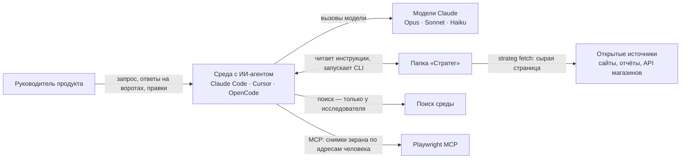
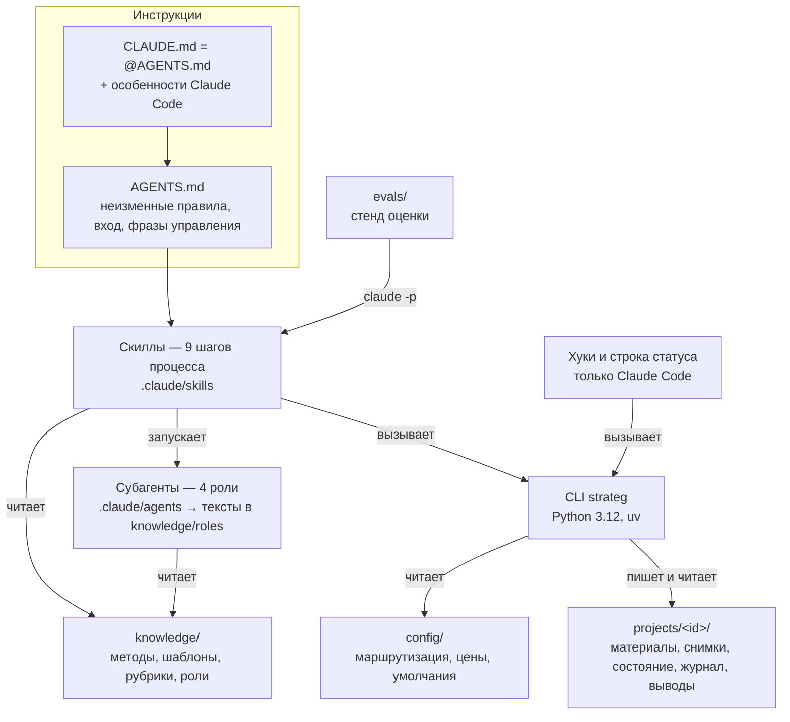
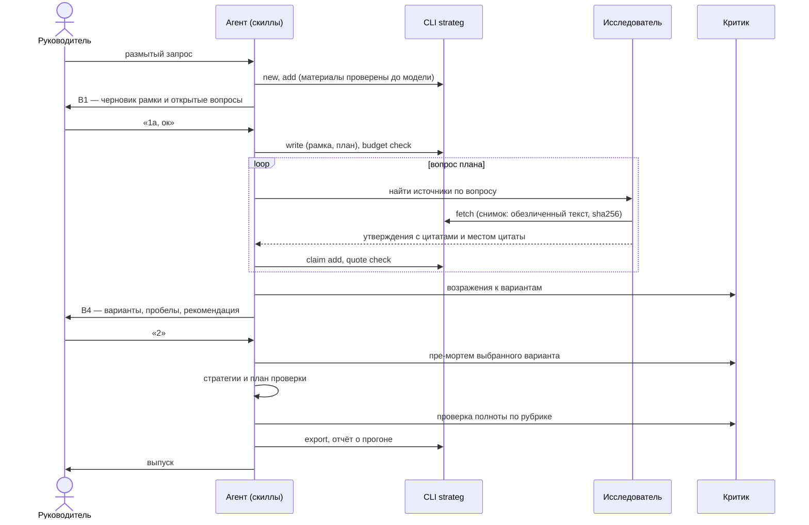

# Архитектура «Стратега»

| | |
|---|---|
| Версия | 0.3 от 06.11.2026 |
| Формат | arc42 кратко, диаграммы C4 (Mermaid) |
| Поведение агента | [Путь пользователя и сценарии](user-journey.md) |
| Решения | [ADR](adr/README.md) — у каждого компонента ожидаемая польза и способ замера |

## 1. Цели и ограничения
**Цели качества** — в порядке важности:
1. **Проверяемость выводов.** Каждое существенное сведение прослеживается до цитаты в снимке источника (КО-1, ОМ-2, ОМ-4).
2. **Продолжение без потерь и повторов** — в новом чате, на другом компьютере, в другой среде (УА-3, ДУ-5, ДУ-6).
3. **Экономичность.** Полная стоимость известна, бюджет держится (ТР-3, КО-4).
4. **Переносимость.** Ядро работает в нескольких средах; без возможностей Claude Code путь тот же, с оговорками (ДУ-6, ТР-1).
5. **Безопасность данных.** Только открытое; персональные данные, закрытые данные и инструкции из источников отсекаются (ТР-5).

**Ограничения:**
- репозиторий — папка с инструкциями, знаниями и скриптами, а не автономная программа;
- среда — любая из тех, что читают `AGENTS.md`; основная — Claude Code;
- модели Claude по подписке или по API; обязательных платных сервисов сверх этого нет;
- Windows и macOS, кириллица и пробелы в путях;
- только открытые источники и собственные материалы пользователя.

## 2. Контекст (C4, уровень 1)

Руководитель продукта работает только со средой: пишет запрос, отвечает на воротах, правит. Среда читает инструкции из папки «Стратег» и вызывает модель. Всё, что меняет состояние проекта, среда делает через CLI `strateg`. Поиск — встроенный в среду и доступен только исследователю. Страницы целиком скачивает CLI. Playwright MCP снимает экраны только по адресам, которые дал человек.

## 3. Контейнеры (C4, уровень 2)

| Контейнер | Где | Что делает | ADR |
|---|---|---|---|
| Инструкции | `AGENTS.md`, `CLAUDE.md` | Неизменные правила, вход в работу, таблица фраз управления | [0001](adr/0001-portable-core.md), [0006](adr/0006-workflow-gates-modes.md) |
| Скиллы | `.claude/skills/` | Шаги процесса: `strateg`, `frame`, `research`, `interview`, `options`, `strategy`, `package`, `update`, `follow-up` | [0001](adr/0001-portable-core.md), [0006](adr/0006-workflow-gates-modes.md) |
| Субагенты | `.claude/agents/`, `knowledge/roles/` | Исследователь, критик, синтетический респондент | [0007](adr/0007-subagents.md) |
| Хуки, строка статуса | `.claude/settings.json`, `.claude/hooks/` | Сводка при старте, права ролей и бюджет, учёт ошибок и стоимости | [0009](adr/0009-hooks-accelerators.md), [0010](adr/0010-cost-budget.md) |
| CLI `strateg` | `src/strateg/` | Единственный путь изменения состояния проекта | [0002](adr/0002-cli-single-interface.md) |
| Методика | `knowledge/` | Карточки методов, шаблоны выходов, рубрики, тексты ролей, источники по умолчанию | [0003](adr/0003-project-folder-layers.md) |
| Проект | `projects/<id>/` | Всё по одной задаче | [0003](adr/0003-project-folder-layers.md) |
| Настройки | `config/` | Маршрутизация, таблица цен, бюджет и сроки по умолчанию | [0008](adr/0008-routing.md), [0010](adr/0010-cost-budget.md) |
| MCP | `.mcp.json` и копии для сред | Playwright — снимки экрана для разбора интерфейсов | [0013](adr/0013-mcp.md) |
| Стенд оценки | `evals/` | Прогоны `claude -p`, сравнение с обычным чатом и аналитиком | [0015](adr/0015-evaluation.md) |

## 4. CLI: модули (C4, уровень 3)
Имена команд предварительные. Форматы файлов задаёт `docs/data-model.md`.

| Модуль | Команды | Что отвечает | Уровень |
|---|---|---|---|
| Проект | `new`, `list`, `status [--line \| --brief]`, `doctor` | Создание проекта, сводка «где остановились», строка статуса, проверка среды | минимум |
| Журнал и шаги | `step start`, `step done`, `step fail`, `gate open`, `gate answer`, `mode`, `stop`, `event error` | Отметки выполнения с ключом идемпотентности, события ворот, режим, «прервано», ошибки | минимум |
| Файлы выхода | `write` (виды `frame`, `plan`, `gaps`, `options`, `promises`, `verification`, `decisions`) | Рамка с версиями, вопросы плана, пробелы, варианты, обещания, план проверки, решения: проверка схемой, версии в `history/`, откат при новых ошибках | минимум |
| Материалы и источники | `add`, `fetch`, `source` | Регистрация материалов с проверкой ПДн и закрытых данных до модели; снимок страницы — обезличенный текст с регионом (не чаще запроса в секунду к хосту, `robots.txt` уважается); список адресов для разбора интерфейсов | минимум |
| Утверждения | `claim add`, `claim replace`, `claim revoke`, `claim list`, `quote check`, `affected` | Реестр, правила типов, проверка цитаты, затронутое по связям | минимум; `affected` — доп. уровень |
| Затраты и бюджет | `cost record`, `budget check`, `route` | Стоимость с пометкой точности, отказ в платном действии, модель роли | минимум; `route` — доп. уровень |
| Решения | `due`, `metric add`, `impact`, `diff` | «Что решать сейчас», значения показателей от человека, затронутое новым сведением, «было → стало» после выпуска; решение записывает `write` | доп. уровень |
| Поиск | `search` | Полнотекстовый поиск по снимкам, утверждениям и методике | доп. уровень |
| Передача и экспорт | `pack`, `new --from`, `export` | Архив проекта, копия примера, HTML и PDF | минимум — `pack`; остальное — доп. уровень |

Команды пишут понятные сообщения по-русски, а с `--json` выдают машинный вывод для скиллов и хуков.

**События пути пользователя и команды:**

| Событие журнала | Кто пишет |
|---|---|
| «запрос получен» | `new` |
| ворота открыты, ответ | `gate open`, `gate answer` |
| начало и отметка выполнения | `step start`, `step done` |
| «прервано» | `status --brief` при продолжении: действие с началом и без отметки |
| ошибка инструмента | `event error` — из скилла или хука |
| смена режима | `mode` |
| выбор модели и повышение | `route`; если `route` не вызван — хук запуска субагента (причина «route не вызван») |
| «отказ хука» | хук `PreToolUse`: что запрещено и что делать вместо; пишется от имени `хук`, если есть активный проект |
| «граница прав не активна» | хук `PreToolUse`, когда вход не похож на Claude Code: раз за сессию |
| «задание исследователю» | хук запуска субагента: текст задания, вопрос `ВП-n` сверен с планом |
| правка человека | `write`, `claim replace`, `claim revoke` с флагом `--by пользователь` |
| «изменено вне агента» | `status --brief`: хеш файла, который пишет CLI, не совпал с записанным |
| «найдена инструкция в источнике» | `fetch` и `add`: пометка «подозрительный» в снимке; что она не исполнена, подтверждает тест С-10 |

## 5. Контекст и знания
| Что | Когда в окне модели | Размер | ADR |
|---|---|---|---|
| `AGENTS.md` — правила, вход, фразы управления | всегда | до 200 строк | [0001](adr/0001-portable-core.md) |
| Описания 9 скиллов | всегда — список среды | одна-две строки на скилл | [0006](adr/0006-workflow-gates-modes.md) |
| Тело одного скилла | на его шаге | до 500 строк | [0006](adr/0006-workflow-gates-modes.md) |
| Сводка «где остановились» | в начале разговора и после сжатия | несколько строк от `status --brief` | [0002](adr/0002-cli-single-interface.md), [0009](adr/0009-hooks-accelerators.md) |
| Карточка метода, шаблон, рубрика | по ссылке из скилла, когда нужна | одна карточка | [0003](adr/0003-project-folder-layers.md) |
| Утверждения и цитаты | по номеру или через поиск | только нужные | [0005](adr/0005-claims-quote-check.md), [0012](adr/0012-knowledge-search.md) |
| Страница целиком | никогда в основном окне: её читает исследователь в своём контексте | — | [0004](adr/0004-sources-snapshots.md), [0007](adr/0007-subagents.md) |

Состояние живёт в файлах проекта, а не в окне модели. Поэтому сжатие контекста или новый чат ничего не теряют. После сжатия Claude Code возвращает начало вызванных скиллов, а хук `SessionStart` с источником `compact` — сводку состояния ([скиллы](https://code.claude.com/docs/en/skills), [хуки](https://code.claude.com/docs/en/hooks)). Память между сеансами — файлы проекта и статусы утверждений. Прежний ответ агента фактом не становится.

## 6. Как это работает
### 6.1. Основной путь

Остановка, уточнение и исправление обычной фразой — в разделах 6.2 и 6.3. Сопровождение после выбора — [ADR-0016](adr/0016-decisions-follow-up.md).

### 6.2. Продолжение после перерыва
1. Новый чат. В Claude Code хук `SessionStart` вызывает `strateg status --brief`, в других средах это делает правило `AGENTS.md`.
2. CLI читает состояние и журнал. Действие с началом и без отметки выполнения получает событие «прервано».
3. Агент показывает сводку «где остановились» и продолжает со следующего действия. Ключ идемпотентности не даёт повторить выполненное.

### 6.3. Уточнение, исправление и новые данные
В минимальном объёме затронутое находит скилл по ссылкам на номера в файлах проекта. Команда `affected` — доп. уровень, она делает то же детерминированно.

1. `write`, `claim replace` или `claim revoke` записывают правку. Прежняя версия остаётся в журнале и в `history/`.
2. `affected` идёт по связям «рамка → вопрос плана → источник → утверждение → вариант → раздел стратегии → решение» и возвращает затронутое и ворота, на которых человек уже ответил.
3. Агент показывает список и оценку. Если затронуты такие ворота — ждёт подтверждения, потом пересчитывает и показывает «было → стало».

### 6.4. Бюджет
Перед каждым платным действием — скачать источник, начать шаг, запустить субагента — скилл вызывает `budget check`. При исчерпании CLI отказывает. В Claude Code остановку держит хук `PreToolUse`: перед каждым платным вызовом он пересчитывает расход по транскриптам основного агента и субагентов и при исчерпании отказывает всем инструментам, кроме команд `strateg` и записи выпуска с пометкой о неполноте. Поэтому бюджет срабатывает посреди хода. В других средах остановка держится на вызове `budget check` из скилла и отказе CLI на ближайшей границе шага. Это слабее, и так и написано в отчёте о прогоне.

## 7. Сквозные решения
### 7.1. Безопасность
Граница прав ([ADR-0011](adr/0011-data-safety.md)): в одной роли не сочетаются недоверенный вход, доступ к чувствительному и внешний канал.
- Весь веб — у исследователя: поиск, `strateg fetch`, снимки экрана по адресам человека. Он читает только веб-снимки в `sources/` и методику, материалов пользователя не видит: текст из них лежит в `inputs/`.
- У основного агента выхода в сеть нет: ни веб-инструментов, ни `strateg fetch`, ни Playwright; сетевые команды Bash и встроенные субагенты среды запрещены. Он видит цитаты и выжимки исследователя, помеченные как недоверенные. Исследователю он передаёт только вопрос плана, задание пишется в журнал.
- CLI скачивает страницы вежливо: не чаще одного запроса в секунду к хосту, снимки кэшируются в проекте, `User-Agent` свой, `Disallow` в `robots.txt` уважается ([ADR-0004](adr/0004-sources-snapshots.md)). При запрете в реестр источников пишется «запрещено robots.txt», а человеку — подсказка сохранить страницу вручную.
- Состояние меняется только через CLI, а CLI проверяет правила реестра: инструкция, дошедшая в цитате, не запишет факт из синтетики и не обойдёт схему.
- Проверку структуры вывода и правил реестра делает CLI, а не модель.

В Claude Code границу держат права и хуки. В других средах остаются проверки CLI и пометки, и это записывается в отчёт о прогоне.

### 7.2. Хуки Claude Code
Настройки — `.claude/settings.json`, скрипты-обёртки — `.claude/hooks/`, логика — `src/strateg/hooks/` ([ADR-0009](adr/0009-hooks-accelerators.md)). Обёртка читает JSON со стандартного ввода и вызывает `strateg.hooks.runner`; решение — чистая функция «вход хука + окружение + сведения о проекте → решение», её тестируют без среды.

| Событие | Что делает | При сбое |
|---|---|---|
| `SessionStart` | `status --brief` (`compact` — с `--peek`) в контекст; нет проекта — одна строка | не блокирует |
| `PreToolUse` | права по `agent_type`, запуск субагента и модель роли из `config/routing.yaml`, охрана `.env`, `~/.strateg/`, `.tmp/pending/`, `evals/` и правил | блокирует: «хук прав не сработал: …» |
| `PostToolUseFailure` | `event error`: инструмент и обрезанный текст ошибки без строк, похожих на ключи | не блокирует |

Журнал и `state.yaml` хук пишет тем же кодом, что и CLI (`src/strateg/storage.py`), под межпроцессной блокировкой папки проекта: параллельные хуки и команда не теряют событий. Запись основного агента без `STRATEG_DEV=1` — только `outputs/` и `.tmp/` активного проекта, поиск — только с `path`. Пути приводятся до проверки (`..`, `~`, `%USERPROFILE%`, `$HOME`, обратная черта, регистр на Windows и macOS, UNC, символические ссылки), команды Bash исследователя сверяются с одним шаблоном. Разбор Bash основного агента снижает риск, но не гарантирует защиту. Хук `PreToolUse` на типовой вызов отвечает за доли секунды; запуск субагента дороже, потому что читает проект и таблицу маршрутов. Проверка бюджета и учёт стоимости по транскриптам (`SubagentStop`, `Stop`) добавляются отдельным пакетом: точка входа — `runner.run_pre_tool_use`. Правила по `agent_type` подтверждены на Claude Code; для Cursor поля входа в документации не описаны, поэтому там действует только охрана, а отчёт пишет «граница прав не активна».

### 7.3. Переносимость
| Возможность | Claude Code | Cursor | OpenCode |
|---|---|---|---|
| Инструкции | `CLAUDE.md` → `@AGENTS.md` | `AGENTS.md` | `AGENTS.md` |
| Скиллы | `.claude/skills` | `.claude/skills` | `.claude/skills` |
| Субагенты | `.claude/agents` | `.claude/agents` без поля `tools`, с `readonly` | роль в основном контексте с пометкой «проверка не независимая» |
| Хуки | да | исполняет `.claude/settings.json` с урезанным набором событий; правила по ролям не активны — `agent_type` не подтверждён | плагины на JS есть, но не используются — скиллы сами вызывают CLI |
| Стоимость | транскрипт и строка статуса | токены × таблица цен или «нет данных» | токены × таблица цен или «нет данных» |
| MCP | `.mcp.json` | `.cursor/mcp.json`, генерируется | `opencode.json`, генерируется |

Codex и GigaCode читают скиллы из своих папок. Для них `scripts/sync_skills.py` создаёт копию по запросу ([ADR-0001](adr/0001-portable-core.md)); работа в этих средах не проверяется и не заявляется.

Источники: документация [Claude Code](https://code.claude.com/docs/en/memory), [Cursor](https://cursor.com/docs/context/skills), [OpenCode](https://opencode.ai/docs/skills/) — обращение 04.11.2026.

### 7.4. Кодировки и пути
UTF-8 во всех файлах, окончания строк LF, хуки запускаются с `PYTHONUTF8=1`. В файлах проекта только относительные пути. `strateg doctor` проверяет кодировку консоли, запись в `projects/`, версию SQLite, наличие Node (предупреждение при версии ниже 22) и gitleaks.

## 8. Решения
Полный список — [docs/adr/README.md](adr/README.md).

## 9. Риски
| Риск | Что делаем |
|---|---|
| В Cursor во входе хука может не быть `agent_type`, и правила по ролям не различат роли | Хук распознаёт среду и не применяет такие правила, событие «граница прав не активна»; проверка на живой установке |
| Вне Claude Code модель пропускает вызов CLI из скилла, и журнал или бюджет неполны | Отказ CLI на ближайшей границе шага; проверка сценарием С-12 в Cursor и OpenCode; ограничение — в отчёте о прогоне |
| Строка статуса не работает в расширении VS Code | Основной учёт стоимости — по транскриптам основного агента и субагентов (`SubagentStop`, `Stop`, проверка в `PreToolUse`); строка статуса — только для сверки |
| Claude Code недоступен проверяющему, например из России | Cursor или OpenCode по сценарию С-12; готовый демо-проект и видео для просмотра без запуска |
| Node или Playwright не установлены | Разбор интерфейсов по снимкам человека; `doctor` предупреждает |
| Точность проверки смысла цитат критиком неизвестна | Отдельной роли классификатора нет: по замеру она хуже порога и снята; пары проверяет критик в режиме «полнота», первая проверка — живой прогон и абляция ([ADR-0007](adr/0007-subagents.md)) |
| В сборке Python SQLite старше 3.34 | `strateg doctor` предупреждает; запасной путь — колонка со стеммированным текстом ([ADR-0012](adr/0012-knowledge-search.md)) |
| Сайт не отдаёт текст без браузера или запрещает робота в `robots.txt` | Пробел «нужен браузер» или «запрещено robots.txt»; файл, сохранённый человеком в `inputs/` |
| Цитата с подменённой цифрой или вставленным «не» проходит проверку | Только точное вхождение после нормализации; числа и отрицания в найденном месте сверяются ([ADR-0005](adr/0005-claims-quote-check.md)) |
| Стоимость вне Claude Code — оценка | Пометка точности в каждой записи и в отчёте о прогоне |

## 10. Связь с требованиями
| ID | ADR |
|---|---|
| ОМ-1, ТР-4 | [0006](adr/0006-workflow-gates-modes.md) |
| ОМ-2 | [0004](adr/0004-sources-snapshots.md), [0005](adr/0005-claims-quote-check.md), [0006](adr/0006-workflow-gates-modes.md) |
| ОМ-3 | [0004](adr/0004-sources-snapshots.md), [0005](adr/0005-claims-quote-check.md), [0006](adr/0006-workflow-gates-modes.md) |
| ОМ-4 | [0005](adr/0005-claims-quote-check.md), [0006](adr/0006-workflow-gates-modes.md), [0007](adr/0007-subagents.md) |
| ОМ-5.1, ОМ-5.2 | [0006](adr/0006-workflow-gates-modes.md), [0014](adr/0014-outputs-export.md) |
| ОМ-5.3 | [0006](adr/0006-workflow-gates-modes.md), [0014](adr/0014-outputs-export.md), [0016](adr/0016-decisions-follow-up.md) |
| УА-1 | [0006](adr/0006-workflow-gates-modes.md) |
| УА-2 | [0003](adr/0003-project-folder-layers.md); раздел 5 |
| УА-3 | [0002](adr/0002-cli-single-interface.md), [0003](adr/0003-project-folder-layers.md), [0009](adr/0009-hooks-accelerators.md) |
| УА-4 | [0002](adr/0002-cli-single-interface.md), [0010](adr/0010-cost-budget.md), [0014](adr/0014-outputs-export.md) |
| ДВ-1 | [0007](adr/0007-subagents.md), [0011](adr/0011-data-safety.md) |
| ДВ-2 | [0004](adr/0004-sources-snapshots.md), [0011](adr/0011-data-safety.md) |
| ДВ-3 | [0004](adr/0004-sources-snapshots.md), [0013](adr/0013-mcp.md) |
| ДВ-4 | [0003](adr/0003-project-folder-layers.md) |
| ДВ-5 | [0016](adr/0016-decisions-follow-up.md) |
| ДВ-6 | [0003](adr/0003-project-folder-layers.md), [0005](adr/0005-claims-quote-check.md), [0012](adr/0012-knowledge-search.md), [0016](adr/0016-decisions-follow-up.md) |
| ДУ-1 | [0007](adr/0007-subagents.md), [0008](adr/0008-routing.md) |
| ДУ-2 | [0001](adr/0001-portable-core.md), [0007](adr/0007-subagents.md), [0009](adr/0009-hooks-accelerators.md) |
| ДУ-3 | [0002](adr/0002-cli-single-interface.md), [0013](adr/0013-mcp.md) |
| ДУ-4 | [0005](adr/0005-claims-quote-check.md), [0012](adr/0012-knowledge-search.md) |
| ДУ-5 | [0002](adr/0002-cli-single-interface.md), [0009](adr/0009-hooks-accelerators.md) |
| ДУ-6 | [0001](adr/0001-portable-core.md), [0003](adr/0003-project-folder-layers.md) |
| ДУ-7 | [0015](adr/0015-evaluation.md) |
| ТР-1 | [0001](adr/0001-portable-core.md) |
| ТР-2 | [0001](adr/0001-portable-core.md), [0002](adr/0002-cli-single-interface.md), [0012](adr/0012-knowledge-search.md), [0013](adr/0013-mcp.md) |
| ТР-3 | [0008](adr/0008-routing.md), [0009](adr/0009-hooks-accelerators.md), [0010](adr/0010-cost-budget.md), [0012](adr/0012-knowledge-search.md) |
| ТР-5.1 | [0004](adr/0004-sources-snapshots.md), [0011](adr/0011-data-safety.md) |
| ТР-5.2 | [0009](adr/0009-hooks-accelerators.md), [0011](adr/0011-data-safety.md) |
| ТР-5.3 | [0004](adr/0004-sources-snapshots.md), [0007](adr/0007-subagents.md), [0009](adr/0009-hooks-accelerators.md), [0011](adr/0011-data-safety.md), [0013](adr/0013-mcp.md) |
| ТР-5.4 | [0003](adr/0003-project-folder-layers.md), [0011](adr/0011-data-safety.md) |
| СД-1 | [Указатель ADR](adr/README.md), эта архитектура |
| СД-2 | [0014](adr/0014-outputs-export.md) |
| КО-1 | [0004](adr/0004-sources-snapshots.md), [0005](adr/0005-claims-quote-check.md), [0007](adr/0007-subagents.md) |
| КО-2 | [0007](adr/0007-subagents.md), [0008](adr/0008-routing.md), [0015](adr/0015-evaluation.md); раздел «Польза и замер» каждого ADR |
| КО-3 | [0001](adr/0001-portable-core.md), [0002](adr/0002-cli-single-interface.md), [0015](adr/0015-evaluation.md) |
| КО-4 | [0010](adr/0010-cost-budget.md), [0014](adr/0014-outputs-export.md), [0015](adr/0015-evaluation.md) |
